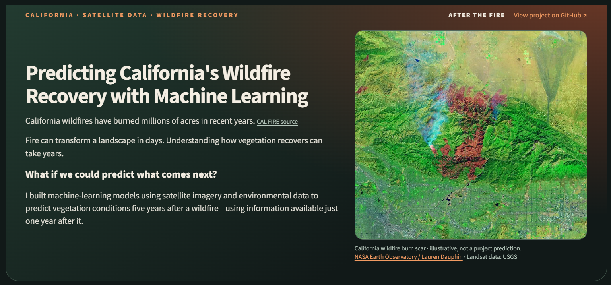
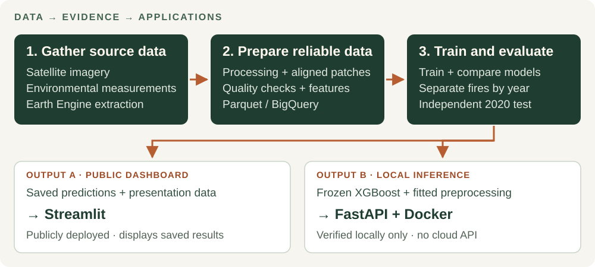

# After the Fire: Predicting California's Wildfire Recovery

**Can measurements from the first growing season help forecast vegetation conditions in the fifth?**

I built an end-to-end geospatial machine-learning pipeline to answer that question across California wildfires. It combines satellite imagery and environmental measurements, compares tree-based and neural models, and tests forecasts on wildfires from a later year not used to develop the models. The unexpected result: **deep learning led during validation, but XGBoost generalized better on the independent 2020 test set.**

**[Explore the Live Dashboard](https://after-the-fire.streamlit.app)** · [Results](#independent-test-results) · [Implementation](#implementation-and-repository-guide) · [Run locally](#run-the-dashboard-locally)

[](https://after-the-fire.streamlit.app)

| Study at a glance | Verified result |
|---|---|
| Study population | **151 California wildfires**, 2015–2020 |
| Independent test cohort | **37 fires from 2020**, **30,606** evaluated 90 × 90 m patches |
| Best patch-weighted test MAE | **0.0767 NBR**, original fitted XGBoost |
| Improvement over historical-average prediction | **51.45% lower MAE** |
| Improvement over first-season persistence | **63.39% lower MAE** |

Each landscape patch is a 90 × 90 m area being studied. MAE measures average absolute prediction error; lower is better. These percentages are **relative reductions in mean absolute prediction error**, not prediction accuracy or percentage vegetation recovery. Fifth-season Normalized Burn Ratio (NBR) is a satellite-derived indicator of vegetation condition, not a percentage of ecological recovery.

## Explore the results

The [public Streamlit dashboard](https://after-the-fire.streamlit.app) lets visitors:

- Select a wildfire on the California map or search by name.
- Explore mapped landscape patches and compare predicted vegetation, observed vegetation, and prediction errors.
- Switch between XGBoost, Random Forest, CNN and CNN + tabular fusion.
- Compare saved per-fire scores, observed-versus-predicted values and simple baselines.

Every displayed observation and prediction comes from the completed evaluation. **The dashboard does not run inference or depend on the local API.** The NASA Earth Observatory hero image is illustrative; it is not a project prediction. [Data provenance](explorer/presentation/PROVENANCE.md) · [Image attribution](explorer/assets/README.md)

## Independent test results

For the original fitted models, I trained on **2015–2017** fires and used **2018–2019** validation data to develop and compare models. Fires from **2020** were held out for the independent test. Entire fires stay within one split. Inputs stop at the end of the first complete post-fire growing season; the target is fifth-season NBR.

All four models below were evaluated on the **same ordered 30,606 test patches across 37 fires**. These are the four models displayed in the dashboard, with saved metrics rounded to four decimals.

| Model | Patch MAE ↓ | RMSE ↓ | R² ↑ | Equal-fire MAE ↓ |
|---|---:|---:|---:|---:|
| **XGBoost** | **0.0767** | **0.1063** | **0.6784** | **0.0642** |
| Random Forest | 0.0776 | 0.1069 | 0.6749 | 0.0651 |
| CNN + tabular fusion | 0.0847 | 0.1145 | 0.6266 | 0.0668 |
| CNN | 0.0855 | 0.1128 | 0.6374 | 0.0699 |

MAE measures average absolute error in NBR units; RMSE penalizes large residuals more strongly. R² compares squared errors with a constant test-cohort-mean reference. Equal-fire MAE gives each fire equal weight instead of weighting by its patch count.

Two simple reference predictions (baselines) show how much the models improve on predicting the historical training average or assuming no change after Season 1:

| Baseline | Test MAE | XGBoost relative MAE reduction |
|---|---:|---:|
| Original 2015–2017 training-target mean | 0.1580 | 51.45% |
| First-season NBR persistence: no change through Season 5 | 0.2096 | 63.39% |

Fusion's validation MAE was **0.0664**, compared with XGBoost's **0.0751**. On the later cohort, fusion's MAE increased to **0.0847**, while XGBoost achieved **0.0767**. This ranking reversal illustrates why development performance alone is insufficient evidence of future generalization. It does not establish why either model behaved differently.

The scientific experiment archive retains **eight fitted model records across two training strategies**, including combined-cohort refits. The dashboard intentionally presents only the original four. The refitted XGBoost achieved the best equal-fire MAE across all eight; original XGBoost won the primary patch-weighted MAE. Choosing it for local serving after inspecting test outcomes is a post-test decision, not a second independent validation. [Saved comparisons and baselines](explorer/presentation/summary.json)

## From source data to a usable application



Landsat, MTBS, LANDFIRE, terrain, Daymet and LCMS supplied imagery, environmental measurements and quality checks. Shared geographic grids, validity masks and unique patch keys kept imagery, tabular features and targets aligned. Regional rasters were cropped locally into two-channel 15 × 15 chips; the central 3 × 3 pixels represent each 90 m prediction patch. Missing-pixel preprocessing was fitted on training data only.

The final tabular comparison uses **18 no-climate predictors**; fusion receives their 70 encoded/scaled columns alongside imagery. Daymet was part of source engineering and earlier analysis, not the final no-climate serving model. LCMS supports retrospective eligibility/QA rather than acting as a prediction feature.

**Final release architecture:** Streamlit is publicly hosted. FastAPI exposes `/health`, `/predict` and `/docs` for the frozen XGBoost pipeline; Docker packages that service for local use. Native Windows and Linux-container predictions were manually verified to match for the synthetic example. **Cloud-hosted inference is not implemented or planned for this release.**

## Implementation and repository guide

| Area | Tools and entry points |
|---|---|
| Geospatial/data engineering | Earth Engine, GeoPandas, Rasterio, PyProj, Parquet/PyArrow, BigQuery/SQL; [source modules](src/wildfire_recovery_forecasting), [production contract](docs/phase3_production_contract.md) |
| Modeling | scikit-learn, Random Forest, XGBoost, PyTorch CNN/fusion; [tabular modeling](src/wildfire_recovery_forecasting/modeling.py), [CNN architectures](src/wildfire_recovery_forecasting/cnn.py) |
| Experimentation | MLflow tracking, persistent Optuna studies, chronological validation and seed checks; [training](scripts/research_operators/manual_phase6_train.py), [tuning](scripts/research_operators/manual_phase6_optuna.py) |
| Final evaluation | Frozen-artifact checks, matched patch keys, per-fire and baseline comparisons; [evaluation entrypoint](scripts/research_operators/manual_phase7_evaluate.py) |
| Applications | FastAPI, Pydantic, Uvicorn, Docker; Streamlit Community Cloud, PyDeck and Plotly; [inference guide](docs/inference_service.md), [dashboard guide](explorer/README.md) |
| Reproducibility | Python 3.12, uv lockfile, manifests/checksums and pytest; [tests](tests), [public-data packager](scripts/build_explorer_presentation.py) |

`notebooks/` preserves source proofs of concept and modeling exploration; `notes/` contains public engineering decisions. All 30 original research operators are preserved unchanged in [`scripts/research_operators/`](scripts/research_operators/README.md). They document the research but require the [original layout](#historical-research-layout) to run. Some initiate cloud work; they are not needed to explore this portfolio.

## Run the dashboard locally

From the repository root, use Python 3.12 and an isolated presentation environment. PowerShell:

```powershell
py -3.12 -m venv .venv
.\.venv\Scripts\python.exe -m pip install -r explorer/requirements.txt
.\.venv\Scripts\python.exe -m streamlit run explorer/streamlit_app.py `
  --server.address 127.0.0.1 `
  --server.port 8501
```

If the project's `.venv` already exists, skip its creation. Open `http://127.0.0.1:8501`; stop with Ctrl+C. No credentials, private weights or research database are required. Public basemaps need internet access. Do not install the full research environment merely to explore the dashboard.

The committed [presentation bundle](explorer/presentation) contains fire metadata, patch geometry, saved outcomes/predictions and metric summaries, with source hashes and attribution. It is an intentional, curated public extract—not the complete research dataset.

For local model inference, follow the separate [FastAPI/Docker guide](docs/inference_service.md). It requires the trusted, excluded model pickle containing fitted preprocessing; a public clone does **not** include those weights. The loader checks the frozen artifact hash and feature schema. [Synthetic request example](examples/predict_request.json)

Full scientific reproduction additionally requires authenticated source access, excluded data/model artifacts and the staged extraction contracts. The public repository is not a one-command rerun of all cloud extraction and training.

### Historical research layout

The designated `research-v1-working` snapshot is commit `cbd13f167393098e4a7735ecb2e5fdcef4d1a199`, before reorganization. See the [archive guide](scripts/research_operators/README.md) for snapshot/tag status and recovery instructions. Use a separate checkout of that revision for historical research tests and verification; do not run the full research test suite from the presentation branch. The snapshot does not include excluded datasets, model weights or experiment databases.

The current application checks are `tests/test_explorer.py` and `tests/test_api.py`. Historical research tests remain in `tests/` as evidence, but many import the original root operators and require the original layout.

## Interpretation and limits

- **NBR is not ecological recovery percentage.** Forecasts could help prioritize monitoring or investigation, but operational benefits and restoration outcomes were not measured.
- **Coverage is selective.** Evaluated patches come from one selected study area per fire, not every pixel of each perimeter. Eligibility includes retrospective QA.
- **Fire-disjoint is not spatially independent.** Nearby patches are correlated; limited training/validation context overlap was documented. Sensitivity checks do not prove independence.
- **Validation informed selection repeatedly.** Hyperparameter searches and checkpoints used the same validation cohort. Seed checks address limited training randomness, not unseen-year uncertainty.
- **No causal spatial-information claim.** Models differ in inputs, preprocessing and tuning; controlled spatial ablations were not performed. Future operational use would require separate validation, not reuse of the 2020 outcomes for tuning.

The project is complete as an evaluated research pipeline, public results explorer and locally verified serving implementation.
